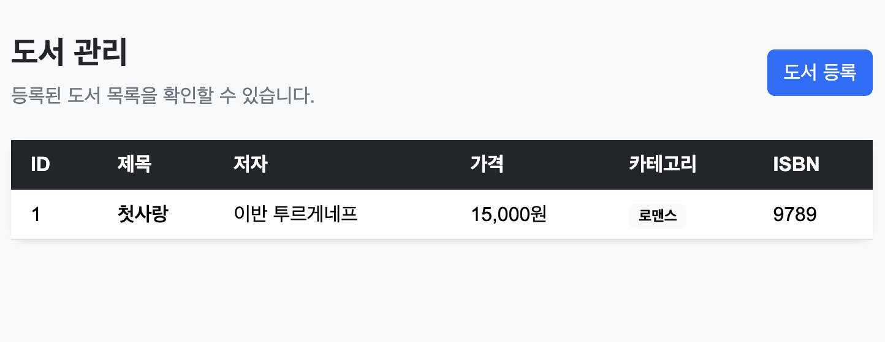
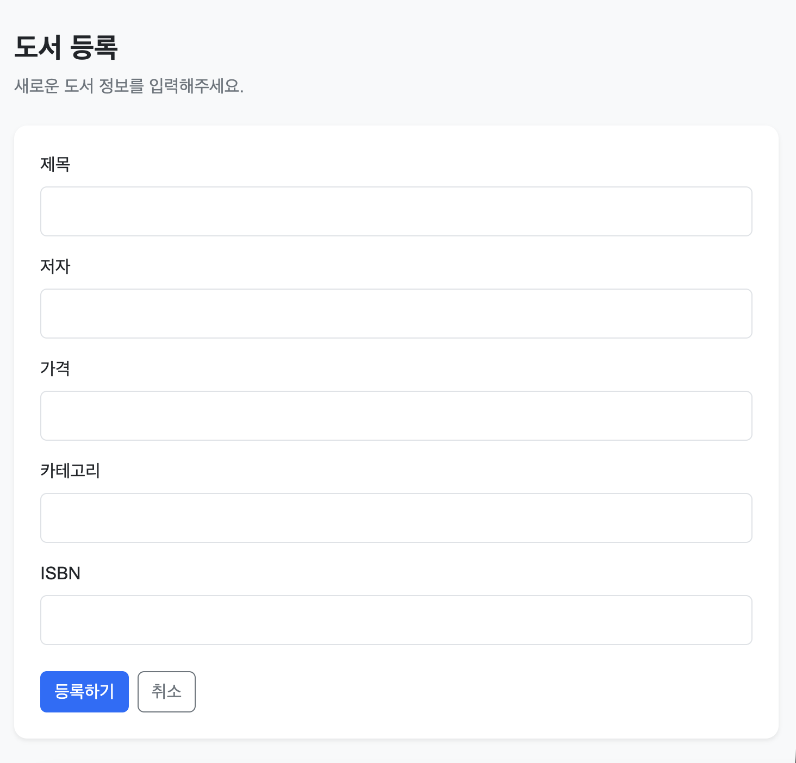

# Book Management Web Application

## 1. 프로젝트 소개

### 프로젝트 주제

Spring Boot와 Thymeleaf를 이용한 도서 관리 웹 애플리케이션이다. Java Collection을 이용한 Memory 기반 저장소를 사용하며, 도서 목록 조회와 도서 등록 기능을 제공한다.

### Render 배포 URL

- 배포 URL: 배포 후 URL 입력

### 사용 기술

- Java 17
- Spring Boot
- Gradle
- Spring Web
- Thymeleaf
- HTML / CSS
- Bootstrap 5
- Java Collection

### 프로젝트 구조

```text
src
├── main
│   ├── java
│   │   └── org.example.week04.java_web_crud4
│   │       ├── controller
│   │       │   ├── BookWebController.java
│   │       │   └── BookController.java
│   │       ├── service
│   │       │   └── BookService.java
│   │       ├── repository
│   │       │   ├── BookRepository.java
│   │       │   └── MemoryBookRepository.java
│   │       ├── domain
│   │       │   └── Book.java
│   │       └── dto
│   │           └── BookRequest.java
│   └── resources
│       ├── templates
│       │   └── books
│       │       ├── list.html
│       │       └── form.html
│       └── static
│           └── css
│               └── style.css
└── build.gradle
```

### 실행 방법

1. 프로젝트를 GitHub에서 Clone하거나 로컬에 다운로드한다.
2. JDK 17 이상의 Java 개발 환경을 준비한다.
3. IntelliJ 또는 터미널에서 프로젝트를 연다.
4. Gradle 의존성을 동기화한다.
5. 애플리케이션을 실행한다.
6. 브라우저에서 `http://localhost:8080/books`에 접속한다.

### 주요 화면

#### 1. 도서 목록 화면

도서의 ID, 제목, 저자, 가격, 카테고리, ISBN을 표 형태로 출력한다. 신규 등록 버튼을 통해 도서 등록 화면으로 이동할 수 있다.

<!-- 도서 목록 화면 스크린샷 삽입 -->



#### 2. 도서 등록 화면

제목, 저자, 가격, 카테고리, ISBN을 입력하고 등록 버튼을 눌러 새로운 도서를 등록할 수 있다.

<!-- 도서 등록 화면 스크린샷 삽입 -->



### Web Endpoint

| HTTP Method | URL | 기능 |
|---|---|---|
| GET | `/books` | 전체 도서 목록 조회 |
| GET | `/books/new` | 도서 등록 Form 출력 |
| POST | `/books` | 입력한 도서 데이터 등록 |

## 2. 이번 과제 키워드

- **@Controller**: HTTP 요청을 처리하고 View 이름을 반환하는 Controller를 정의하는 어노테이션이다.
- **Thymeleaf**: 서버에서 전달받은 데이터를 HTML에 출력하는 템플릿 엔진이다.
- **Model**: Controller에서 View로 데이터를 전달하는 객체이다.
- **@ModelAttribute**: HTML Form에서 전달된 데이터를 DTO 객체에 바인딩하는 데 사용한다.
- **HTML Form**: 사용자가 도서 정보를 입력하고 서버로 전송하는 HTML 요소이다.

## 3. 핵심 내용 정리

1. `@Controller`는 HTML View를 반환하는 데 사용하고, `@RestController`는 일반적으로 객체나 데이터를 HTTP 응답 본문으로 반환하는 데 사용한다.
2. Controller에서 `Model`에 데이터를 저장하면 Thymeleaf 템플릿에서 해당 데이터를 사용할 수 있다.
3. Thymeleaf의 `th:each`와 `th:text`를 사용하면 Collection에 저장된 도서 데이터를 HTML 목록으로 출력할 수 있다.

## 4. Weekly Report

### Key Learning
1. Spring Boot의 `@Controller`와 Thymeleaf를 연결하여 서버 데이터를 HTML 화면에 출력하는 방법.
2. HTML Form의 데이터를 `@ModelAttribute`를 이용하여 DTO 객체로 전달받는 방법.
3. POST 요청 처리 후 Redirect와 GET 요청을 수행하는 PRG Pattern의 동작 방식.

### Web UI Flow

브라우저에서 `/books`에 GET 요청을 보내면 Controller가 요청을 처리한다. Controller는 Service를 통해 Repository에서 도서 목록을 조회하고, 조회 결과를 Model에 저장한다. Thymeleaf는 Model에 전달된 데이터를 이용하여 HTML 화면을 생성한다.

**실행 흐름**

Browser → Controller → Service → Repository → Memory → Model → Thymeleaf → HTML

### Form Flow

사용자가 도서 등록 화면에서 데이터를 입력하고 등록 버튼을 누르면 HTML Form이 POST 요청을 보낸다. Controller는 `@ModelAttribute`를 이용하여 입력 데이터를 `BookRequest` 객체로 전달받고, Service를 통해 도서 데이터를 등록한다. 등록이 완료되면 `/books`로 Redirect하여 목록을 다시 조회한다.

**실행 흐름**

HTML Form → Controller → Service → Repository → Memory → Redirect → GET → HTML

### Problem & Solution

Thymeleaf를 이용한 목록 화면을 구현하는 과정에서 HTML View가 정상적으로 렌더링되지 않는 문제가 발생했다. Gradle 실행 환경에서 의존성을 확인하고 애플리케이션을 다시 실행하여 문제를 해결했다.

### Code Review

```java
@PostMapping("/books")
public String create(@ModelAttribute BookRequest request) {
    bookService.create(request);
    return "redirect:/books";
}
```

이 코드는 HTML Form에서 전달된 데이터를 `BookRequest` 객체로 전달받아 도서를 등록하고, 등록 완료 후 도서 목록으로 이동시키는 핵심 코드다.

### AI Usage

AI를 활용하여 Thymeleaf 기반 도서 목록 및 등록 화면의 HTML 구조와 Bootstrap 디자인을 작성했다.

### Reflection

이번 과제를 통해 서버에서 조회한 데이터를 HTML 화면에 출력하는 과정과 사용자가 입력한 데이터를 서버로 전달하는 과정을 이해했다. 또한 Controller, Service, Repository의 역할을 분리하면 각 계층의 책임을 명확하게 유지할 수 있다는 점을 알게 되었다. 추후에는 데이터베이스를 연결하여 애플리케이션을 재실행해도 데이터가 유지되도록 구현하는 방법을 학습하고 싶다.

### 건의사항

없음